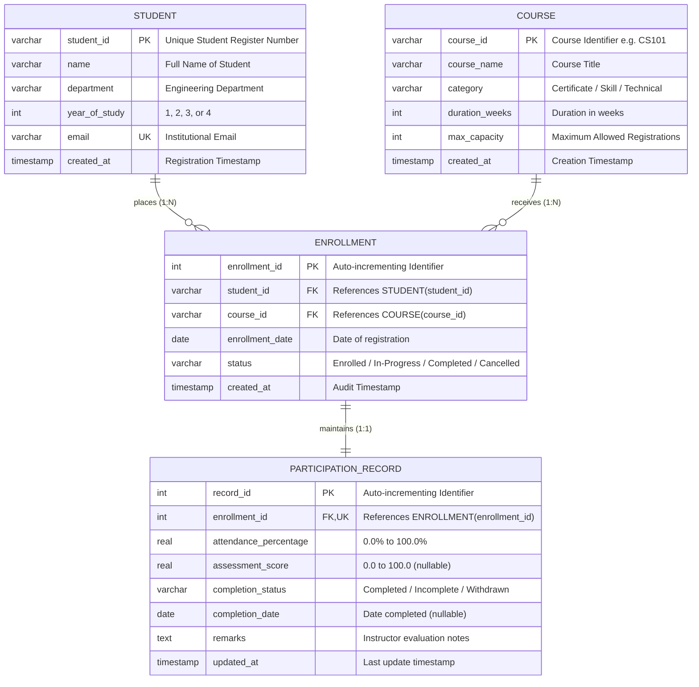

# DATABASE DESIGN, RELATIONAL MODEL & NORMALIZATION REPORT
## Online Course Registration and Student Enrollment Analysis System

---

**Institution:** Velalar College of Engineering and Technology, Erode - 12  
**Department:** Information Technology  
**Academic Year:** 2026-27 (ODD) | **Class:** 25IT3A  
**Course Code:** 25ITT31 - Database Management Systems  
**Scenario:** 17  
**Author / Primary Submitter:** Dhanush .K (**Register No:** 732925ITR017)  
**Assigned Register Numbers:** 17, 47, 77, 107  

---

## 1. Entity-Relationship (ER) Diagram

The system's data model comprises four primary entities: `STUDENT`, `COURSE`, `ENROLLMENT`, and `PARTICIPATION_RECORD`.



### Cardinality and Relationship Semantics
1. **STUDENT to ENROLLMENT (1 : N):**
   - A student can enroll in zero, one, or many distinct courses.
   - Each enrollment record belongs to exactly one student.
   - Constraint: A student cannot enroll in the same course more than once (`UNIQUE(student_id, course_id)`).
2. **COURSE to ENROLLMENT (1 : N):**
   - A course can have zero, one, or up to `max_capacity` active student enrollments.
   - Each enrollment record specifies exactly one course.
3. **ENROLLMENT to PARTICIPATION_RECORD (1 : 1):**
   - Each confirmed enrollment initiates exactly one participation record.
   - Enforced by `UNIQUE(enrollment_id)` on `participation_records`.

---

## 2. Relational Model & Schema Specifications

The relational schema represents the logical structure with data types, primary keys (PK), foreign keys (FK), and business constraints.

### 2.1 Table: `students`
- **Primary Key:** `student_id`
- **Candidate Keys:** `{student_id}`, `{email}`

| Column | Data Type | Constraints | Description |
|---|---|---|---|
| `student_id` | `VARCHAR(20)` | `PRIMARY KEY` | Student Register Number |
| `name` | `VARCHAR(100)` | `NOT NULL` | Student full legal name |
| `department` | `VARCHAR(50)` | `NOT NULL` | Department (`IT`, `CSE`, `ECE`, `AIDS`, `MECH`, `CIVIL`) |
| `year_of_study`| `INTEGER` | `NOT NULL, CHECK (year_of_study BETWEEN 1 AND 4)` | Current academic year (1st to 4th) |
| `email` | `VARCHAR(100)` | `UNIQUE` | Unique institutional email address |
| `created_at` | `TIMESTAMP` | `DEFAULT CURRENT_TIMESTAMP` | System creation timestamp |

### 2.2 Table: `courses`
- **Primary Key:** `course_id`
- **Candidate Keys:** `{course_id}`

| Column | Data Type | Constraints | Description |
|---|---|---|---|
| `course_id` | `VARCHAR(20)` | `PRIMARY KEY` | Unique alphanumeric course identifier |
| `course_name` | `VARCHAR(150)` | `NOT NULL` | Descriptive title of course |
| `category` | `VARCHAR(50)` | `NOT NULL, CHECK (category IN ('Certificate Course', 'Skill Development', 'Technical Training'))` | Approved course category |
| `duration_weeks`| `INTEGER` | `NOT NULL, CHECK (duration_weeks > 0)` | Length in weeks |
| `max_capacity`| `INTEGER` | `NOT NULL, CHECK (max_capacity > 0)` | Maximum intake capacity limit |
| `created_at` | `TIMESTAMP` | `DEFAULT CURRENT_TIMESTAMP` | System creation timestamp |

### 2.3 Table: `enrollments`
- **Primary Key:** `enrollment_id`
- **Candidate Keys:** `{enrollment_id}`, `{(student_id, course_id)}`
- **Foreign Keys:**
  - `student_id` $\to$ `students(student_id)` (`ON DELETE CASCADE`)
  - `course_id` $\to$ `courses(course_id)` (`ON DELETE CASCADE`)

| Column | Data Type | Constraints | Description |
|---|---|---|---|
| `enrollment_id`| `INTEGER` | `PRIMARY KEY AUTOINCREMENT` | Unique enrollment record ID |
| `student_id` | `VARCHAR(20)` | `NOT NULL, REFERENCES students(student_id)` | Enrolled student |
| `course_id` | `VARCHAR(20)` | `NOT NULL, REFERENCES courses(course_id)` | Enrolled course |
| `enrollment_date`| `DATE` | `NOT NULL` | Date when registration took place |
| `status` | `VARCHAR(20)` | `NOT NULL DEFAULT 'Enrolled' CHECK (status IN ('Enrolled', 'In-Progress', 'Completed', 'Cancelled'))` | Lifecycle state |
| `created_at` | `TIMESTAMP` | `DEFAULT CURRENT_TIMESTAMP` | Record timestamp |
| *(Table)* | | `UNIQUE(student_id, course_id)` | **Prevents duplicate registrations** |

### 2.4 Table: `participation_records`
- **Primary Key:** `record_id`
- **Candidate Keys:** `{record_id}`, `{enrollment_id}`
- **Foreign Keys:**
  - `enrollment_id` $\to$ `enrollments(enrollment_id)` (`ON DELETE CASCADE`)

| Column | Data Type | Constraints | Description |
|---|---|---|---|
| `record_id` | `INTEGER` | `PRIMARY KEY AUTOINCREMENT` | Unique performance tracking ID |
| `enrollment_id`| `INTEGER` | `NOT NULL UNIQUE, REFERENCES enrollments(enrollment_id)` | Parent enrollment |
| `attendance_percentage`| `REAL` | `DEFAULT 0.0 CHECK (attendance_percentage BETWEEN 0 AND 100)` | Session attendance rate |
| `assessment_score` | `REAL` | `DEFAULT NULL CHECK (assessment_score IS NULL OR (assessment_score BETWEEN 0 AND 100))` | Evaluated score |
| `completion_status`| `VARCHAR(20)`| `NOT NULL DEFAULT 'Incomplete' CHECK (completion_status IN ('Completed', 'Incomplete', 'Withdrawn'))` | Course milestone |
| `completion_date`| `DATE` | `DEFAULT NULL` | Date when marked completed |
| `remarks` | `TEXT` | `NULL` | Instructor remarks |
| `updated_at` | `TIMESTAMP` | `DEFAULT CURRENT_TIMESTAMP` | Timestamp of last grade update |

---

## 3. Database Normalization Analysis

Database normalization is the systematic technique of organizing relational schemas to eliminate insertion, update, and deletion anomalies while minimizing data redundancy.

### 3.1 Functional Dependencies (FDs)
From the domain rules of the educational institution:
1. $FD_1: \text{student\_id} \to \{\text{name}, \text{department}, \text{year\_of\_study}, \text{email}, \text{created\_at}\}$
2. $FD_2: \text{email} \to \{\text{student\_id}, \text{name}, \text{department}, \text{year\_of\_study}\}$
3. $FD_3: \text{course\_id} \to \{\text{course\_name}, \text{category}, \text{duration\_weeks}, \text{max\_capacity}, \text{created\_at}\}$
4. $FD_4: \text{enrollment\_id} \to \{\text{student\_id}, \text{course\_id}, \text{enrollment\_date}, \text{status}, \text{created\_at}\}$
5. $FD_5: \{\text{student\_id}, \text{course\_id}\} \to \{\text{enrollment\_id}, \text{enrollment\_date}, \text{status}\}$
6. $FD_6: \text{record\_id} \to \{\text{enrollment\_id}, \text{attendance\_percentage}, \text{assessment\_score}, \text{completion\_status}, \text{completion\_date}, \text{remarks}\}$
7. $FD_7: \text{enrollment\_id} \to \{\text{record\_id}, \text{attendance\_percentage}, \text{assessment\_score}, \text{completion\_status}, \text{completion\_date}, \text{remarks}\}$

---

### 3.2 Unnormalized Form (UNF)
In an unnormalized flat file representation:
```
REGISTRATION_FLAT(student_id, name, department, year_of_study, email,
                  {course_id, course_name, category, duration_weeks, max_capacity,
                   enrollment_date, status, attendance_percentage, assessment_score,
                   completion_status, completion_date})
```
**Anomalies Present in UNF:**
- **Repeating Groups:** A student registering for multiple courses causes multivalued attributes for course details and grades.
- **Redundancy:** Course name, category, and max capacity are duplicated for every student enrolled.
- **Update Anomaly:** Modifying a course title requires updating multiple rows; failure leads to inconsistency.
- **Deletion Anomaly:** If the only student in a course withdraws, the course details are wiped from existence.

---

### 3.3 First Normal Form (1NF)
> **Definition:** A relation $R$ is in 1NF if and only if all underlying attribute domains contain only atomic (indivisible) values and there are no repeating groups.

**Actions Taken to Reach 1NF:**
- Eliminated repeating groups by creating distinct tuple rows for each `(student_id, course_id)` combination.
- Enforced single scalar values for all columns (e.g., student name is a single atomic string, year of study is an integer).
- Designated a primary key candidate: `(student_id, course_id)`.

**Resulting 1NF Relation:**
```
ENROLLMENT_1NF(student_id, name, department, year_of_study, email,
               course_id, course_name, category, duration_weeks, max_capacity,
               enrollment_date, status, attendance_percentage, assessment_score, completion_status)
```
*Key:* `(student_id, course_id)`

---

### 3.4 Second Normal Form (2NF)
> **Definition:** A relation $R$ is in 2NF if and only if it is in 1NF and every non-prime attribute is fully functionally dependent on the primary key (no partial functional dependencies).

**Analysis of 1NF Dependencies:**
- Primary Key: `(student_id, course_id)`
- Partial Dependencies:
  - $\text{student\_id} \to \{\text{name}, \text{department}, \text{year\_of\_study}, \text{email}\}$ *(Depends only on part of the composite key!)*
  - $\text{course\_id} \to \{\text{course\_name}, \text{category}, \text{duration\_weeks}, \text{max\_capacity}\}$ *(Depends only on part of the composite key!)*

**Decomposition into 2NF:**
To eliminate partial dependencies, we decompose the relation into three relations:
1. `STUDENTS(student_id, name, department, year_of_study, email)`
   - Primary Key: `student_id`
   - All non-prime attributes depend fully on `student_id`.
2. `COURSES(course_id, course_name, category, duration_weeks, max_capacity)`
   - Primary Key: `course_id`
   - All non-prime attributes depend fully on `course_id`.
3. `ENROLLMENT_DETAILS(enrollment_id, student_id, course_id, enrollment_date, status, attendance_percentage, assessment_score, completion_status)`
   - Primary Key: `enrollment_id` (surrogate) with `(student_id, course_id)` as alternate key.
   - All non-prime attributes depend fully on the complete key.

---

### 3.5 Third Normal Form (3NF)
> **Definition:** A relation $R$ is in 3NF if and only if it is in 2NF and no non-prime attribute is transitively dependent on the primary key (no $X \to Y$ where $Y \to Z$ and $X \to Z$).

**Analysis of 2NF Relations:**
- In `STUDENTS`, all attributes are directly determined by `student_id`. No transitive dependency exists.
- In `COURSES`, all attributes are directly determined by `course_id`. No transitive dependency exists.
- In `ENROLLMENT_DETAILS`, attendance and assessment scores represent academic performance metrics that can evolve independently of the registration lifecycle event itself. Specifically, academic assessment tracking is optional or updated at variable milestones after enrollment.
- Separating participation records creates a clear domain boundary between administrative registration and academic evaluation.

**Decomposition into 3NF Relations:**
1. `STUDENTS`: Holds student demographic data.
2. `COURSES`: Holds course curriculum and quota constraints.
3. `ENROLLMENTS`: Holds the relationship binding student and course with enrollment date and status.
4. `PARTICIPATION_RECORDS`: Holds evaluation metrics (attendance, score, completion) tied to `enrollment_id`.

---

### 3.6 Boyce-Codd Normal Form (BCNF)
> **Definition:** A relation $R$ is in BCNF if and only if for every non-trivial functional dependency $X \to Y$, the determinant $X$ is a superkey.

Let us verify all four tables:
1. **`students`:**
   - $FD_1: \text{student\_id} \to \text{all attributes}$. Determinant is primary key (superkey).
   - $FD_2: \text{email} \to \text{all attributes}$. Determinant is candidate key (superkey).
   - **Satisfies BCNF.**
2. **`courses`:**
   - $FD_3: \text{course\_id} \to \text{all attributes}$. Determinant is primary key (superkey).
   - **Satisfies BCNF.**
3. **`enrollments`:**
   - $FD_4: \text{enrollment\_id} \to \text{all attributes}$. Determinant is primary key (superkey).
   - $FD_5: \{\text{student\_id}, \text{course\_id}\} \to \text{all attributes}$. Determinant is alternate key (superkey).
   - **Satisfies BCNF.**
4. **`participation_records`:**
   - $FD_6: \text{record\_id} \to \text{all attributes}$. Determinant is primary key (superkey).
   - $FD_7: \text{enrollment\_id} \to \text{all attributes}$. Determinant is unique candidate key (superkey).
   - **Satisfies BCNF.**

**Conclusion:** The database schema is in **Boyce-Codd Normal Form (BCNF)**, guaranteeing zero redundancy and zero insertion/deletion/update anomalies.

---

## 4. Key Analytical SQL Queries & Explanations

### Query 1: Course Enrollment & Available Seats (Requirement 6.1)
```sql
SELECT 
    c.course_id,
    c.course_name,
    c.category,
    c.duration_weeks,
    c.max_capacity,
    COUNT(CASE WHEN e.status IN ('Enrolled', 'In-Progress', 'Completed') THEN e.enrollment_id END) AS current_enrolled,
    (c.max_capacity - COUNT(CASE WHEN e.status IN ('Enrolled', 'In-Progress', 'Completed') THEN e.enrollment_id END)) AS available_seats,
    ROUND(
        (COUNT(CASE WHEN e.status IN ('Enrolled', 'In-Progress', 'Completed') THEN e.enrollment_id END) * 100.0) / c.max_capacity, 
        2
    ) AS seat_utilization_pct,
    CASE 
        WHEN (c.max_capacity - COUNT(CASE WHEN e.status IN ('Enrolled', 'In-Progress', 'Completed') THEN e.enrollment_id END)) <= 0 THEN 'FULL'
        WHEN (c.max_capacity - COUNT(CASE WHEN e.status IN ('Enrolled', 'In-Progress', 'Completed') THEN e.enrollment_id END)) <= 2 THEN 'FILLING FAST'
        ELSE 'AVAILABLE'
    END AS enrollment_status
FROM courses c
LEFT JOIN enrollments e ON c.course_id = e.course_id
GROUP BY c.course_id, c.course_name, c.category, c.duration_weeks, c.max_capacity
ORDER BY current_enrolled DESC;
```
*Explanation:* Computes real-time capacity utilization, calculates remaining seats, and flags courses nearing saturation using conditional aggregation (`COUNT(CASE ...)`).

---

### Query 2: Course Completion and Performance Summary (Requirement 6.2)
```sql
SELECT 
    c.course_id,
    c.course_name,
    COUNT(e.enrollment_id) AS total_enrolled,
    COUNT(CASE WHEN pr.completion_status = 'Completed' THEN 1 END) AS total_completed,
    ROUND(
        (COUNT(CASE WHEN pr.completion_status = 'Completed' THEN 1 END) * 100.0) / NULLIF(COUNT(e.enrollment_id), 0),
        2
    ) AS completion_rate_pct,
    ROUND(AVG(pr.attendance_percentage), 2) AS avg_attendance_pct,
    ROUND(AVG(pr.assessment_score), 2) AS avg_assessment_score
FROM courses c
JOIN enrollments e ON c.course_id = e.course_id
LEFT JOIN participation_records pr ON e.enrollment_id = pr.enrollment_id
GROUP BY c.course_id, c.course_name
ORDER BY total_completed DESC;
```
*Explanation:* Aggregates student outcomes per course, calculating completion percentage and academic marks while guarding against division by zero using `NULLIF`.

---

### Query 3: Department-wise Course Enrollment Distribution (Requirement 6.3)
```sql
SELECT 
    s.department,
    COUNT(DISTINCT s.student_id) AS registered_students,
    COUNT(e.enrollment_id) AS total_enrollments,
    COUNT(CASE WHEN pr.completion_status = 'Completed' THEN 1 END) AS total_completions,
    ROUND(
        (COUNT(CASE WHEN pr.completion_status = 'Completed' THEN 1 END) * 100.0) / NULLIF(COUNT(e.enrollment_id), 0),
        2
    ) AS department_completion_rate_pct
FROM students s
LEFT JOIN enrollments e ON s.student_id = e.student_id
LEFT JOIN participation_records pr ON e.enrollment_id = pr.enrollment_id
GROUP BY s.department
ORDER BY total_enrollments DESC;
```
*Explanation:* Delivers department-level engagement analytics, revealing which academic branches participate most actively and achieve the highest completion rates.
