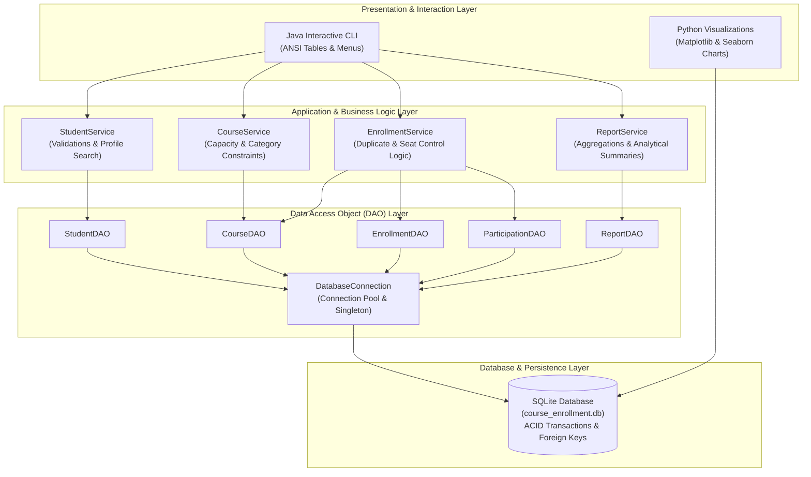
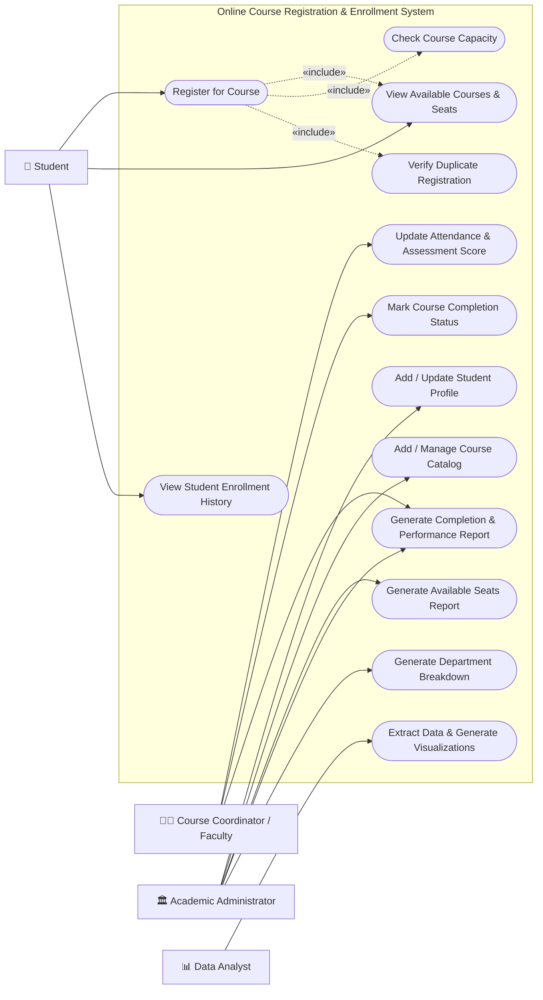
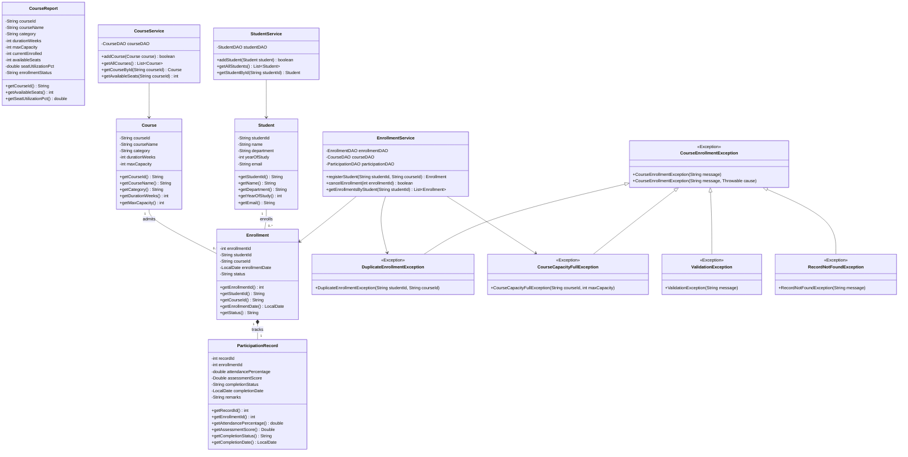
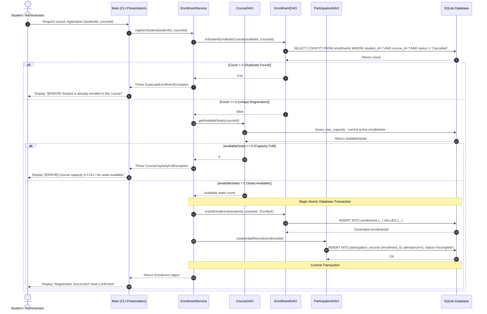

# SYSTEM DESIGN AND ARCHITECTURAL DIAGRAMS
## Online Course Registration and Student Enrollment Analysis System

---

**Institution:** Velalar College of Engineering and Technology, Erode - 12  
**Department:** Information Technology  
**Academic Year:** 2026-27 (ODD) | **Class:** 25IT3A  
**Assessment:** Activity - Project-Based Assessment  
**Scenario:** 17  
**Author / Primary Submitter:** Dhanush .K (**Register No:** 732925ITR017)  
**Assigned Register Numbers:** 17, 47, 77, 107  
**Relevant Courses:**
- 25ITT33: Software Engineering (Architecture, Use Case, Class Diagrams)
- 25ITT32: Java Programming (OOP, Layered Architecture, Exceptions)
- 25ITT31: Database Management Systems (Relational Model, Persistence)
- 25ITC31: Foundations of Data Science (Data Retrieval & Visualization)

---

## 1. Overall System Architecture

The system follows a multi-tiered, decoupled Layered Architecture conforming to the Separation of Concerns (SoC) principle.

### Architectural Layer Responsibilities
1. **Presentation Layer:**
   - **Java CLI (`com.vcet.courseenrollment.Main`):** Provides an interactive, menu-driven command-line interface featuring formatted tabular displays via `TablePrinter`.
   - **Python Analytics Pipeline (`python/enrollment_analysis.py`):** Independently reads the persistence store to generate statistical graphics and summary plots.
2. **Business Logic Layer:**
   - Implements business constraints: duplicate registration blocking, course capacity calculation, student ID validation, and transaction isolation.
3. **Data Access Object (DAO) Layer:**
   - Abstract CRUD operations away from business logic using parameterized `PreparedStatement` instances to guarantee SQL injection safety.
4. **Persistence Layer:**
   - SQLite relational database with strict schema integrity (`PRAGMA foreign_keys = ON;`, `CHECK` constraints, and composite unique indexes).

---

## 2. Use Case Diagram

The Use Case Diagram depicts the system boundary and the interactions between the primary actors (Student, Course Coordinator / Faculty, Academic Administrator, Data Analyst) and system capabilities.

### Actor Descriptions and Permissions
- **Student:** Can browse open course offerings, view available seats, enroll in courses, and review personal participation and course completion progress.
- **Course Coordinator / Faculty:** Records student attendance percentages, enters evaluation scores, and updates completion status (`Incomplete` $\to$ `Completed`).
- **Academic Administrator:** Configures course capacities, registers new students, monitors seat saturation (`AVAILABLE`, `FILLING FAST`, `FULL`), and reviews department-level engagement.
- **Data Analyst:** Executes Python pipelines to extract SQLite records, perform descriptive analytics, and render multi-dimensional charts.

---

## 3. Class Diagram

The Class Diagram illustrates the object-oriented structure, class attributes, method signatures, inheritance, and dependency relationships implemented in `com.vcet.courseenrollment`.

---

## 4. Sequence Diagram: Course Registration Workflow

This diagram shows the sequence of interactions and atomic database operations when a student registers for a course, demonstrating business rule validation, capacity enforcement, and duplicate prevention.

